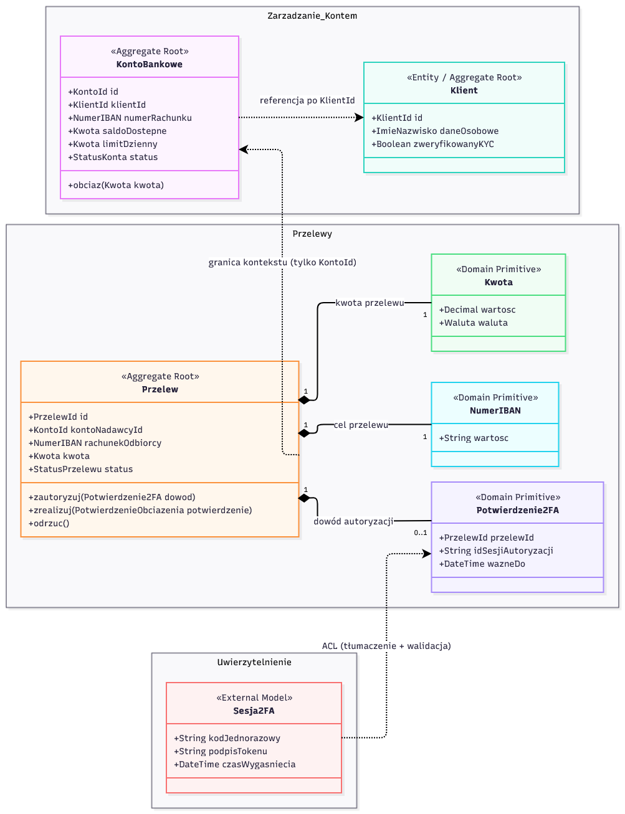

# Zadanie 1 – Domain-Driven Design (Bezpieczna Aplikacja Bankowa)

## Karol Łukasik 310801

## Opis zadania
Celem zadania jest zamodelowanie wybranego fragmentu bezpiecznej aplikacji bankowej (procesu inicjowania, autoryzacji i realizacji przelewu wychodzącego) zgodnie z zasadami Domain-Driven Design. System podzielono na trzy konteksty ograniczone, pomiędzy którymi granice pełnią rolę granic zaufania i minimalizacji danych.

---

## 1. Konteksty Ograniczone

1. **Przelewy (*Core Domain*)**  
   Odpowiada za cykl życia dyspozycji przelewu (maszynę stanów), pilnowanie niezmienników operacji oraz wymuszenie autoryzacji przed realizacją. Nie przechowuje danych osobowych klienta.
2. **Zarządzanie Kontem (*Supporting Domain*)**  
   Przechowuje dane rachunku, saldo, limit dzienny oraz tożsamość właściciela konta (`Klient`). Odpowiada za bezpieczne sprawdzenie limitów i pobranie środków z konta w jednej transakcji.
3. **Uwierzytelnienie (*Generic/Supporting Domain*)**  
   Odpowiada za weryfikację tożsamości użytkownika. Na styku z kontekstem *Przelewy* działa warstwa antykorupcyjna (ACL), która tłumaczy i waliduje zewnętrzne poświadczenie na zaufany obiekt domenowy `Potwierdzenie2FA`.

---

## 2. Diagram modelu domenowego

---

## 3. Przyjęte założenia, formaty danych i niezmienniki

| Element | Typ DDD | Atrybuty i akceptowane formaty | Niezmienniki (reguły bezpieczeństwa) i integracja między kontekstami |
| :--- | :--- | :--- | :--- |
| **`KontoBankowe`** | **Agregat** *(Aggregate Root)* | `id` (`KontoId` – UUIDv4), `klientId` (`KlientId` – UUIDv4), `numerRachunku` (`NumerIBAN`), `saldoDostepne` (`Kwota`), `limitDzienny` (`Kwota`), `status` (`AKTYWNE` / `ZABLOKOWANE`) | Odwołuje się do klienta tylko przez `KlientId`. Nie ma setterów – saldo zmienia się wyłącznie przez metodę `obciaz(kwota)`. Operacja uda się tylko, gdy konto jest `AKTYWNE`, saldo wystarcza, a kwota nie przekracza limitu dziennego. |
| **`Przelew`** | **Agregat** *(Aggregate Root)* | `id` (`PrzelewId` – UUIDv4), `kontoNadawcyId` (`KontoId`), `rachunekOdbiorcy` (`NumerIBAN`), `kwota` (`Kwota`), `status` (`UTWORZONY`, `ZAUTORYZOWANY`, `ZREALIZOWANY`, `ODRZUCONY`) | Łączy się z kontem nadawcy wyłącznie przez `KontoId`. Wymusza kolejność kroków: nie da się zrealizować przelewu bez wcześniejszej autoryzacji 2FA (dla tego konkretnego `PrzelewId`) oraz potwierdzenia pobrania środków z kontekstu *Zarządzanie Kontem*. |
| **`Klient`** | **Encja / Agregat** *(Entity)* | `id` (`KlientId` – UUIDv4), `daneOsobowe` (`ImieNazwisko`, 2–100 znaków), `zweryfikowanyKYC` (Boolean) | Osobny agregat – edycja danych klienta nie blokuje operacji na koncie. Dane klienta nie wychodzą poza kontekst Zarządzanie Kontem. Brak potwierdzonego statusu blokuje możliwość wykonywania przelewów. |
| **`NumerIBAN`** | **Obiekt Wartości** *(Domain Primitive)* | `wartosc` (String: `PL` + 26 cyfr, dokładnie 28 znaków) | Niezmienny po utworzeniu. Przy tworzeniu sprawdza kolejno długość, dozwolone znaki, format oraz sumę kontrolną. Rachunek odbiorcy nie może być taki sam jak rachunek nadawcy. |
| **`Kwota`** | **Obiekt Wartości** *(Domain Primitive)* | `wartosc` (`Decimal`, max 2 miejsca po przecinku), `waluta` (`PLN`, `EUR`, `USD`) | Niezmienny. Odrzuca kwoty mniejsze lub równe `0.00`, dzięki czemu nie da się zrobić przelewu na ujemną kwotę. Waluta przelewu musi zgadzać się z walutą konta. |
| **`Potwierdzenie2FA`** | **Obiekt Wartości** *(Domain Primitive)* | `przelewId` (`PrzelewId`), `idSesjiAutoryzacji` (32 znaki hex), `wazneDo` (DateTime ISO 8601) | Powstaje na granicy kontekstów*Uwierzytelnienie i Przelewy (przez ACL) dopiero po sprawdzeniu ważności i podpisu autoryzacji. Przypisanie do `przelewId` blokuje ponowne użycie tego samego kodu 2FA do innego przelewu. |
